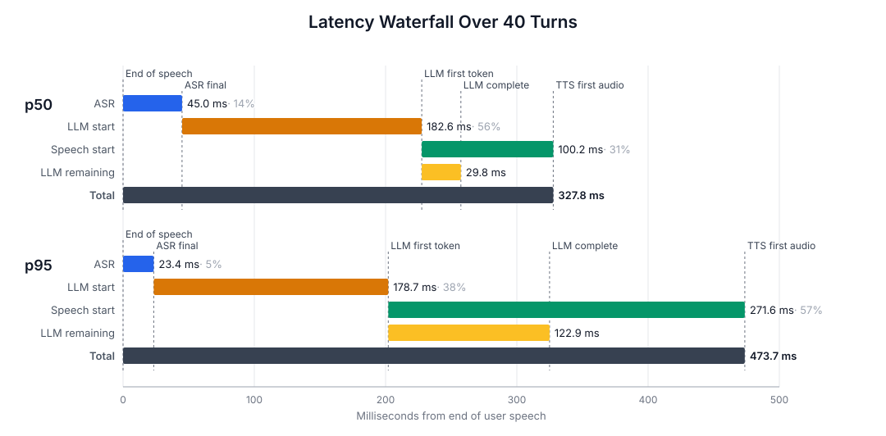

# Assignment 4 report: Hartwell Voice Assistant

**Partners:** Clara Li (`cli725`) and Oankar Patil (`opatil31`)  
**Models:** 
LLM: `meta-llama/Llama-3.2-3B-Instruct`. 
ASR: `faster-whisper-small.en` from the shared cache. 
TTS: `Piper en_US lessac medium voice` from the shared cache.  
**Run behind the figures:** Job ID: 7125302 on one NVIDIA H100 80 GB HBM3; 40 turns; trace: `run_output/trace.jsonl`.

## 1. The system
Each run replays recorded utterances through the full pipeline. ASR transcribes each utterance once the speaker is done. Rules in the `agent.py` file identify common booking intents, and LLM requests extract structured details or interpret other requests. After that, the task state is updated and an LLM call streams the spoken answer, which Piper synthesizes. ASR and interpretation finish before answer generation starts, and TTS can overlap answer generation once a sentence is ready.

The task state lasts for the session and includes timer deadlines, reminders, room-booking constraints, alternatives and proposals. The `agent.py` script includes checks for capacity, equipment, and availability before proposing a room and asks for confirmation before booking. The general planner sees the last six conversation messages plus a state snapshot. The booking extractor instead sees the current utterance, the feature vocabulary and the pending field, with a JSON schema constraining its output. The extracted changes are merged with existing constraints and checks for unstated values. Booking responses are built from the verified state and streamed with constrained decoding to preserve their exact text. Lookup answers receive the knowledge base.

All LLM calls use temperature 0, seed 42, and a 256-token limit. ASR and Piper each get eight CPU threads, with one ASR worker and one ONNX inter-op thread. A single TTS worker synthesizes each sentence as soon as sentence-ending punctuation followed by whitespace appears, and sends any leftover text when the stream ends. Before timing starts, a warm-up pass transcribes the first recording, exercises JSON mode and synthesizes "Ready."

## 2. The latency waterfall



| Interval | At p50 TTFA (ms) | At p95 TTFA (ms) |
|---|---:|---:|
| **TTFA, all turns** | 327.78 | 473.66 |
| ASR: `asr_final` − `end_of_user_speech` | 45.75 | 60.94 |
| LLM start: `llm_first_token` − `asr_final` | 122.58 | 202.69 |
| Speech start: `tts_first_audio` − `llm_first_token` | 135.16 | 256.49 |
| Overlapping LLM generation: `llm_complete` − `llm_first_token` | 50.41 | 125.22 |
These values are pulled from the "stages" section of the `run_output/evaluation/summary.json` file.
**Turns counted:** 40 of 40

**How I treat stages that overlap:** `llm_first_token` marks the first nonblank spoken-answer token, so LLM start includes any interpretation requests and state handling before the spoken answer. Sentence synthesis can overlap answer generation, but first audio followed LLM completion in all 40 measured turns. The LLM remaining stage overlaps the speech-start interval and isn't added to the three TTFA stages.

**How to recompute these numbers:** From the repo root, run `python3 evaluate_run.py`. The evaluation is dependent on `run_output/trace.jsonl`. Outputs are found in `summary.json` in the `run_output/evaluation/` folder.

## 3. Word error rate on our own voices

| Speaker | Utterances | Reference words | Pooled WER | Mean WER per utterance |
|---|---:|---:|---:|---:|
| Clara Li | 20 | 213 | 0.94% (2/213) | 1.08% |
| Oankar Patil | 20 | 171 | 5.85% (10/171) | 6.74% |

The ASR handles Oankar’s voice slightly worse. The difference was sometimes coming from the grammar of the utterance, like a reference of “makerspace” being transcribed into “maker space,” or in utterances that included Oankar’s name, which would be misspelled in the transcription because it’s a less common name. An example utterance of the latter was a reference of “yes please book it under the name oankar” was transcribed into “yes please book it under the name omkar.” The associated recording also had less emphasis placed on the -an part of Oankar, which could also contribute to a transcription of omkar instead of a more phonetically accurate misspelling of onkar.

## 4. The bottleneck

**The dominant stage:** In the p50 waterfall, the LLM start stage contributes the largest share at **182.59 ms**, or **55.71%** of the **327.78 ms** TTFA. The dominating stage for p95 is different. Speech start dominates the p95 waterfall at **271.58 ms / 473.66 ms = 57.34%**.

**Why:** LLM start is long because interpretation and answer generation run sequentially: the agent must finish generating and parsing the interpretation JSON and update task state before requesting the spoken answer. This interval therefore includes the full interpretation request(s) plus the answer request’s startup latency. In the p95 TTFA waterfall, speech start dominates instead, combining sentence buffering, TTS scheduling, and synthesis until the first audio chunk. Although synthesis can overlap answer generation, first audio arrived after answer completion in all 40 turns, with a median gap of 85.36 ms.

**The fix I would ship next:** We would test a more compact JSON plan that excludes unused fields and null values. The agent waits for interpretation to finish before requesting the spoken answer, so generating fewer planning tokens could shorten the LLM start interval. Adding timestamps around the interpretation requests and the start of the answer request can let us measure where the time is spent so we can compare p50 LLM start, p50 TTFA, and task correctness with the current version. The expected effect is that there will be less of a contribution of the LLM start stage in the p50 waterfall.

**One thing I tried that did not help:** We implemented sentence-level streaming so Piper could synthesize completed sentences while the LLM continued generating the answer. However, none of the 40 turns produced audible speech before LLM completion. The first audio arrived at a median of 85.36 ms afterward. This shows that streaming didn't achieve speech before the full answer was generated. 

## 5. Reproducing this

From the repository root on PACE-ICE, with access to the course's shared model cache and `CAI_A4` environment, load all requirements and then run:

```bash
mkdir -p run_output
sbatch recipe/run_agent.sbatch
```

After the job finishes:

```bash
python3 evaluate_run.py
python3 wer/score_wer.py --trace run_output/trace.jsonl --references references.json --details --json
```

Dependency versions are in `recipe/requirements.txt`, and the output trace is written to `run_output/trace.jsonl`

## Appendix: AI-use disclosure

**Tools used:** Codex

**What for:** Codex helped debug and implement `agent.py`, including writing various rules to best help handle the response to the three task families. It was also used to explain the relationship between the implementation and concepts covered in class.

**What I wrote or decided myself:** We chose the separation between request interpretation and spoken answers, the models and tools to use, and the amount of knowledge-base context supplied to the system. We also recorded our own utterances that we think are comprehensive enough to cover a diverse amount of requests across the three task families.

**How I checked it:** We replayed our recordings through the local pipeline and ran the system multiple times using different LLMs to gauge performance differences. We also looked at the `voice_kit/metrics` results that were generated from our runs to see if performance is as we expected.
